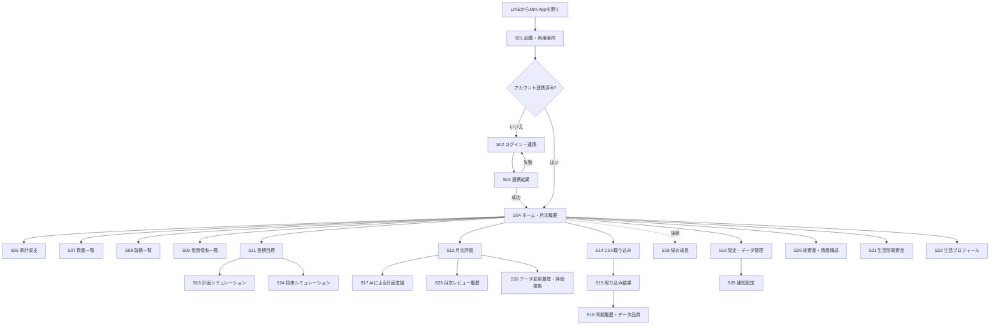
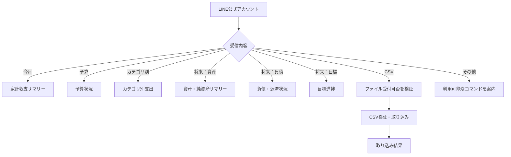

# Catsflow 画面一覧・画面遷移設計

- 更新日：2026-10-16
- 文書状態：論理画面案。画面の実装状況は提供ZIPで未確認
- 方針：LINE Mini App（React + TypeScript）を主画面とする既存方針を維持。独立した通常Webサイトは必要性が確認されるまで作らない。

## 1. 画面一覧

| ID | 画面 | 優先度 | 主な内容 | 状態 |
|---|---|---|---|---|
| S01 | 起動・利用案内 | P0 | Catsflow概要、連携状態 | 論理案 |
| S02 | ログイン／アカウント連携 | P0 | LINEとCatsflowアカウントの連携 | バックエンド関連クラスあり。画面実装・認証安全性は要確認 |
| S03 | 連携結果 | P0 | 成功・失敗・再試行 | 論理案 |
| S04 | ホーム／月次概要 | P1 | 今月の収支、純資産、負債、目標進捗、最終更新日時 | 論理案 |
| S05 | 家計収支 | P1 | 収入・支出・振替、月別推移 | 集計Serviceあり。画面は要確認 |
| S06 | 予算 | P2 | 予算、使用額、残額、使用率 | 予算の永続化構造は要確認 |
| S07 | 資産一覧・資産詳細 | P1 | 預金、現金、投資資産、評価日、出所 | 新規設計が必要 |
| S08 | 負債一覧・負債詳細 | P1 | 残高、金利、返済額、完済見込み | 新規設計が必要 |
| S09 | 投資積立計画 | P1 | 銘柄名、毎月の投資予定額、積立状態 | 新規設計が必要 |
| S10 | 投資信託全体の推移 | P1 | CSV由来の投資信託全体の資産額、基準日、月次推移 | 新規設計が必要 |
| S11 | 長期目標 | P1 | 目標額、期限、進捗、毎月の必要額 | 新規設計が必要 |
| S12 | 月次評価 | P1 | 固定フォーマットの評価、根拠数値、翌月行動 | 新規設計が必要 |
| S13 | 計画シミュレーション | P2 | 貯金・返済・投資配分、ストレステスト | 後続候補 |
| S14 | CSV取り込み | P1 | 対応CSV、ファイル選択／受付、検証 | サービスあり。受付経路・UIは要確認 |
| S15 | 取り込み結果 | P1 | 新規・更新・重複・エラー件数 | 論理案 |
| S16 | 同期履歴・データ品質 | P1 | 最終成功日時、データ基準日、欠損、出所 | `sync_logs`あり。画面は要確認 |
| S17 | AIによる計画支援 | P2 | 評価理由、選択肢、行動案 | 後続候補 |
| S18 | 猫の成長 | P3 | 経験値、レベル、称号、成長履歴 | 後続候補 |
| S19 | 設定・データ管理 | P2 | 手動修正、連携解除、データ削除方針 | 論理案 |
| S20 | 純資産・資産構成 | P1候補 | 資産総額、負債総額、純資産、時系列推移 | 追加予定・未実装確認 |
| S21 | 生活防衛資金 | P2候補 | 目安額、現在の対象現金、差分 | 追加予定・算定基準未決定 |
| S22 | 生活プロフィール | P2候補 | 生活環境、本人負担、今後の予定、優先事項 | 追加予定・項目未決定 |
| S23 | 月次レビュー履歴 | P1候補 | 過去の評価、根拠数値、改善履歴 | 追加予定・保存仕様未決定 |
| S24 | 将来シミュレーション | P2候補 | 積立・返済・生活イベント等のシナリオ比較 | 追加予定・前提条件未決定 |
| S25 | 通知設定 | P2候補 | LINE通知の種類、頻度、停止設定 | 追加予定・配信仕様未決定 |
| S26 | データ変更履歴・評価根拠 | P1/P2候補 | データの訂正履歴、AIコメントの根拠・未取得情報 | 追加予定・既存ログとの分担要確認 |

優先度は提案であり、確定したリリース計画ではない。

## 2. Mini App画面遷移図

## 3. LINEトーク側の遷移（概念）

LINEでのCSVファイル受信は、Messaging APIの仕様・サイズ制約を実装前に検証する。満たさない場合はMini Appのアップロードを主経路とする。

## 4. ホーム画面の優先情報（仮決定）

1. 最新の純資産と基準日
2. 当月の収支・貯蓄実績
3. 負債残高と返済進捗
4. 長期目標の進捗
5. 月次評価への導線
6. データの最終更新日時・未取得情報

データが未登録のカードはゼロ表示にせず、登録案内または未取得表示にする。

## 5. 未決事項

- Mini Appの実装方式・起動設定・画面ルーティング
- 認証方式とログイン画面
- 各画面の項目・グラフ・表示単位
- 目標・資産・負債・投資積立計画の編集操作
- 銘柄別評価額・損益は初期画面に表示しない
- CSVプレビュー要否とファイル受付経路
- AI提案の承認UI
- 猫の経験値ルールと画面上の位置づけ
- 追加予定画面の初期版への含め方と実装優先順位
- 生活プロフィールの入力項目・任意設定・変更履歴
- 生活防衛資金の対象資産と算定方法
- 将来シミュレーションの入力・出力・前提表示
- 通知頻度・停止設定・通知対象
- データ変更履歴の表示範囲とAI根拠表示のUI
