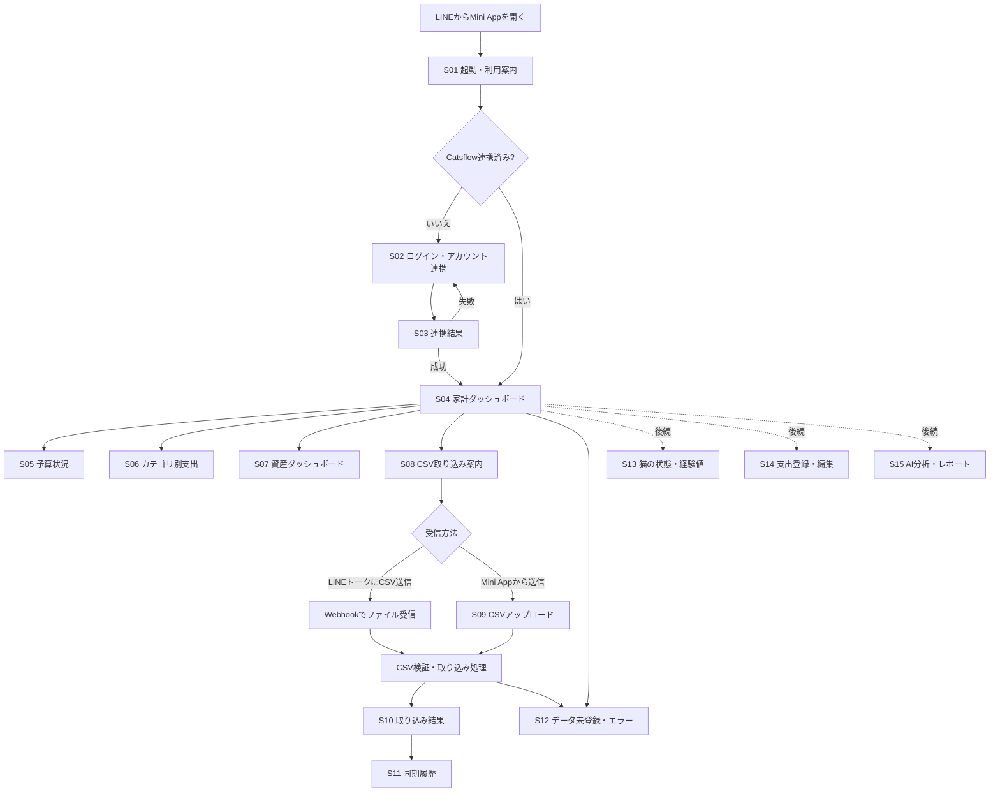
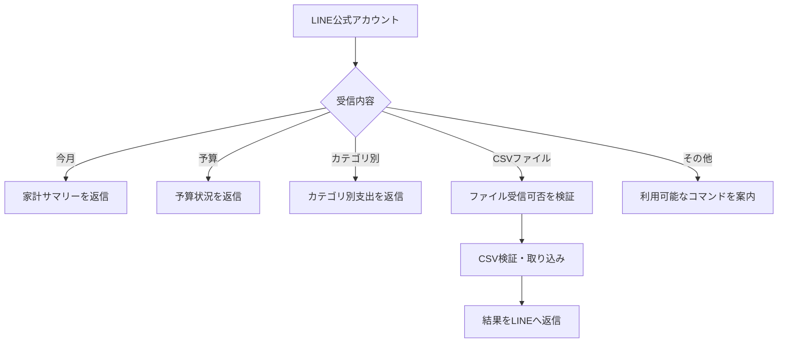

# Catsflow LINE Mini App 画面一覧・画面遷移図

- 文書状態：初期案
- 更新日：2026-10-14
- フロントエンド：React + TypeScript
- 画面方針：LINE Mini App内で完結。独立した通常Webサイトは当面作らない。

## 1. 画面一覧

| ID | 画面 | 初期版 | 目的・主な内容 |
|---|---|---|---|
| S01 | 起動・利用案内 | 対象 | Catsflowの概要、連携状態の確認 |
| S02 | ログイン／アカウント連携 | 対象 | Mini App内でCatsflowアカウントを認証・連携 |
| S03 | 連携結果 | 対象 | 成功・失敗・再試行案内 |
| S04 | 家計ダッシュボード | 対象 | 今月の収入・支出・収支、最終更新日時 |
| S05 | 予算状況 | 対象 | 予算額、使用額、残額、使用率 |
| S06 | カテゴリ別支出 | 対象 | カテゴリごとの金額、一覧・グラフ |
| S07 | 資産ダッシュボード | 対象 | 資産総額、カテゴリ別内訳、推移 |
| S08 | CSV取り込み案内 | 対象 | 対応CSV、送信方法、注意点を案内 |
| S09 | CSVアップロード | 条件付き | LINEトークでファイル受信できない場合、または補助経路 |
| S10 | 取り込み結果 | 対象 | 新規・更新・重複・エラー件数、基準日 |
| S11 | 同期履歴 | 対象 | 最終成功日時、過去の実行結果、エラー状態 |
| S12 | データ未登録／エラー | 対象 | データなし、読み込み失敗、再試行案内 |
| S13 | 猫の状態・経験値 | 後続 | 経験値、レベル、称号、成長履歴 |
| S14 | 支出登録・編集 | 後続 | LINEからの明細登録・変更 |
| S15 | AI分析・レポート | 後続 | 支出傾向、予算超過要因、定期レポート |

「対象」は仕様上の初期スコープを示す。実装順や表示項目は既存Catsflowの実装を確認して調整する。

## 2. 画面遷移図

## 3. LINEトーク側の遷移（概念）

LINEトークでのCSVファイル受信は、LINE Messaging APIの現在の仕様・ファイルサイズ等の制約を実装前に検証する。要件を満たさない場合は、Mini Appアップロードを主経路にする。

## 4. ナビゲーション案

Mini App下部ナビゲーションの候補：

- ホーム
- 予算
- 資産
- データ取り込み
- 猫（後続）

画面数を増やしすぎず、LINE内でよく使う家計・資産確認を少ない操作で開ける構成を目指す。

## 5. 未決事項

- 既存Catsflowの認証方式に合わせたログイン画面
- LINE Mini Appの実際の認証・公開設定
- グラフ種類、日付範囲、表示単位
- LINEトークでファイル受信する際の制約と実現可否
- CSV取り込み前プレビューの要否
- 猫の経験値・レベル設計
